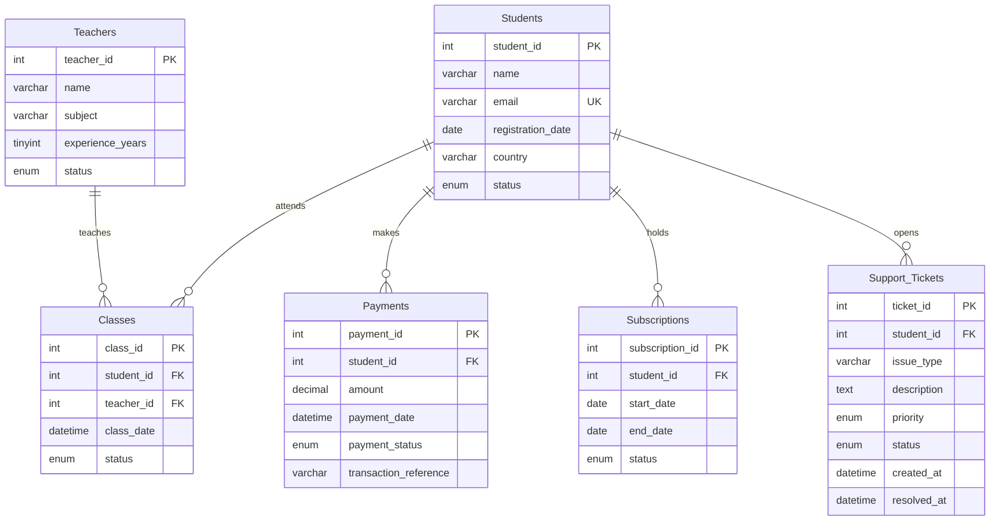

# LearnSphere

LearnSphere is a portfolio SQL project that simulates EdTech operations and technical-support investigations. MySQL 8 is the system of record and the analysis engine; Python generates and loads reproducible sample data, while Streamlit displays results produced by SQL queries.

## Technology

- MySQL 8.0.16+ (InnoDB; `CHECK` constraints are enforced from 8.0.16)
- MySQL Workbench
- Python 3.10+
- pandas, `mysql-connector-python`
- Streamlit and Plotly

## Project layout

```text
sql/
  schema.sql
  modules/                 # SQL learning modules A-E
  investigations/          # Module F: ten operations investigations
scripts/
  generate_data.py         # deterministic data creation and MySQL loading
dashboard/
  app.py                   # dashboard using MySQL queries
```

## Database relationship diagram



Each class, payment, subscription, and ticket belongs to one student; each class also has one teacher. A student can have multiple records in each child table. Student email is unique; transaction references are intentionally not unique so the duplicate-reference incident can be investigated.

## Setup

1. In MySQL Workbench, open and execute [`sql/schema.sql`](sql/schema.sql). This creates the `learnsphere` database and six related tables.
2. From the project root, create a Python virtual environment and install dependencies:

   ```powershell
   py -m venv .venv
   .\.venv\Scripts\Activate.ps1
   pip install -r requirements.txt
   ```

3. Copy `.env.example` to `.env` and set your local MySQL host, username, password, and database. The sample scripts read environment variables; they do not automatically parse `.env`. In PowerShell, load variables into the current session before running:

   ```powershell
   Get-Content .env | ForEach-Object {
       if ($_ -match '^([^#=]+)=(.*)$') {
           [Environment]::SetEnvironmentVariable($matches[1], $matches[2], 'Process')
       }
   }
   ```

4. Generate and load the target data:

   ```powershell
   python scripts\generate_data.py
   ```

   The loader creates 500 students, 50 teachers, 2,000 classes, 1,000 payments, 500 subscriptions, and 300 tickets. It loads the tables in foreign-key order and commits the load as one transaction. Re-running without `--replace` will fail rather than silently duplicate rows. To replace the existing sample rows, pass `--replace`; the script requires typing `DELETE` before it removes data from the six tables. Use only in a local practice database.

5. Run the dashboard from the project root in the same environment:

   ```powershell
   streamlit run dashboard\app.py
   ```

6. Run the generator's deterministic fixture tests:

   ```powershell
   python -m unittest discover -v
   ```

## SQL learning modules

Run the scripts in MySQL Workbench after loading the sample data:

- **A — Fundamentals:** `sql/modules/01_fundamentals.sql`
- **B — Aggregates:** `sql/modules/02_aggregates.sql`
- **C — Joins:** `sql/modules/03_joins.sql`
- **D — Intermediate/advanced:** `sql/modules/04_advanced.sql`
- **E — Data manipulation and transactions:** `sql/modules/05_data_manipulation.sql`
- **F — Troubleshooting:** `sql/investigations/06_troubleshooting.sql`

Module F contains ten separate, commented investigation queries. Thresholds such as “more than three absences,” a 30% cancellation rate, and a 48-hour ticket resolution are operational examples, not universal policy. Validate evidence and business context before changing a customer's account or payment state.

## Deliberate anomaly fixtures

The generator is deterministic for a given seed (default `42`) and includes seeded cases to make the investigations return useful examples:

| Fixture | Seeded record(s) | Investigation |
|---|---|---|
| Successful payment with inactive subscription | Student 1, payment 1 | 1 |
| Failed payment with active subscription | Student 2, payment 2 | 2 |
| Duplicate transaction reference | Payments 1 and 2 | 3 |
| Multiple failed attempts | Student 3, payments 3 and 4 | 4 |
| More than three absences | Student 4, six class records | 5 |
| High teacher cancellation rate | Teacher 1, 24 cancelled of 40 seeded classes | 6 |
| High-priority unresolved tickets | Tickets 1 and 3 | 7 |
| Long ticket resolution | Ticket 2 (40 days) | 8 |
| Expired subscription with recent successful payment | Student 5, payment 5 | 9 |
| Active subscriber with multiple missed classes | Student 6, five absences | 10 |
| Subscription status/date inconsistencies | Students 7-9 | Data-quality follow-up |
| Optional data missing | Some student countries and ticket descriptions | A / data-quality follow-up |

Randomly generated records may also match some investigations. A finding is an investigation lead, not a confirmed root cause. In particular, payment status, subscription dates, and entitlement provisioning can have legitimate timing or integration explanations.

## Resume-ready skills demonstrated

Relational modeling, constraints and indexing, transaction safety, multi-table joins, aggregation, CTEs, window functions, incident triage, support SLA analysis, anomaly detection, reproducible test data, and SQL-backed visualization.
